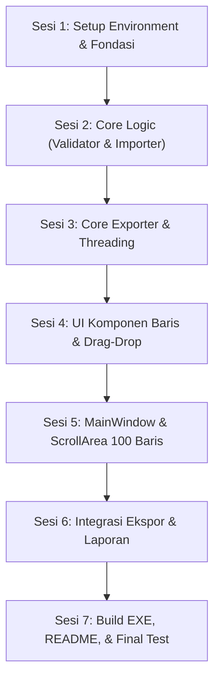

# IMPLEMENTATION ROADMAP: Photo Rename Studio
> **Panduan Praktis Langkah-demi-Langkah untuk Junior Developer**
>
> Proyek: **Photo Rename Studio** (Desktop App Windows)  
> Teknologi: **Python 3.10+**, **PySide6 (Qt for Python)**, **Pillow**  
> Status Dokumen: *Living Document / Multi-Session Roadmap*

---

## 📖 1. Gambaran Proyek

Aplikasi **Photo Rename Studio** adalah aplikasi desktop modern untuk Windows yang memudahkan pengguna mengganti nama banyak foto sekaligus secara teratur.

### Masalah yang Diselesaikan:
Seringkali fotografer, panitia acara, atau staf administrasi memiliki daftar nama orang/produk (misalnya 100 orang dari file Excel/CSV/TXT), dan foto-foto dari kamera dengan nama acak seperti `IMG_4921.JPG`. Mereka ingin mencocokkan foto dengan nama yang sudah disiapkan, lalu mengekspor foto tersebut ke folder tujuan dengan nama baru tanpa merusak foto asli.

### Prinsip Utama Aplikasi (Rule of Law):
1. **Zero Data Loss (File Asli Keramat)**: Foto asli **TIDAK PERNAH** boleh diubah nama aslinya, dipindahkan, atau dihapus. Semua proses ekspor menggunakan mekanisme **Salin (Copy)** ke folder tujuan.
2. **Ekstensi Asli Tetap Utuh**: Jika file asli adalah `.JPG` atau `.png`, nama baru harus tetap mempertahankan ekstensi aslinya (contoh: input nama `Budi Santoso` + foto `DSC001.png` $\rightarrow$ hasil `Budi Santoso.png`).
3. **Validasi Ketat Format Windows**: Windows melarang karakter tertentu (`\ / : * ? " < > |`) dan nama perangkat khusus (`CON`, `PRN`, `AUX`, `NUL`, dll). Aplikasi harus mencegah error sebelum proses ekspor dimulai.
4. **Antarmuka Responsif (No Freezing)**: Menangani 100 baris foto beserta thumbnail dan operasi file I/O berat tidak boleh membuat jendela aplikasi *Not Responding*. Kita akan memanfaatkan `QScrollArea` dan `QThread` (background worker).

---

## 🏗️ 2. Struktur Proyek yang Direkomendasikan

Struktur kode diatur dengan konsep **Separation of Concerns** (Pemisahan Tanggung Jawab). Kode logika pemrosesan data diletakkan di `core/`, sedangkan tampilan visual ada di `ui/`.

```text
photo-rename-studio/
├── src/
│   ├── __init__.py
│   ├── main.py                     # Titik masuk utama aplikasi (entry point)
│   ├── config.py                   # Konstanta (ekstensi foto, batas baris, warna tema)
│   ├── core/
│   │   ├── __init__.py
│   │   ├── validator.py            # Logika validasi nama file Windows & cek duplikasi
│   │   ├── exporter.py             # Logika salin file dengan QThread worker aman
│   │   ├── importer.py             # Parser file TXT & CSV untuk impor nama
│   │   └── image_loader.py         # Helper pembuatan thumbnail efisien (Pillow/QPixmap)
│   ├── ui/
│   │   ├── __init__.py
│   │   ├── main_window.py          # Jendela utama (Header, Toolbar, List Scroll, Footer)
│   │   ├── row_widget.py           # Widget 1 baris (DropZone, Thumbnail, Input Nama, Tombol)
│   │   ├── drop_zone.py            # Komponen khusus Drag & Drop foto
│   │   ├── report_dialog.py        # Dialog modal laporan sukses/gagal ekspor
│   │   └── styles.py               # Tema QSS modern, bersih, minimalis
│   └── utils/
│       ├── __init__.py
│       └── file_utils.py           # Helper sanitasi nama, format ukuran, dll
├── tests/
│   ├── __init__.py
│   ├── test_validator.py           # Pengujian otomatis aturan nama file & Windows
│   ├── test_importer.py            # Pengujian impor file TXT dan CSV
│   └── test_exporter.py            # Pengujian fungsi ekspor & integritas file sumber
├── build_scripts/
│   ├── photo_rename_studio.spec    # Konfigurasi PyInstaller untuk build Windows EXE
│   └── build_exe.py                # Script otomasi build
├── requirements.txt                # Daftar library Python
├── README.md                       # Dokumentasi instalasi dan cara penggunaan
└── IMPLEMENTATION.md               # File panduan ini
```

---

## 🗺️ 3. Roadmap Pengerjaan Multi-Session

Pengerjaan dibagi menjadi **7 Sesi Mandiri**. Setiap sesi memiliki fokus yang jelas, checklist tugas, cara pengujian, serta **Prompt AI yang sudah memuat instruksi commit otomatis**.



---

### 📍 SESI 1: Setup Environment, Struktur Folder & Konfigurasi Dasar

#### 🎯 Tujuan Sesi
Mempersiapkan lingkungan kerja Python virtual environment, menginstal dependensi (`PySide6`, `Pillow`, `pytest`), membuat struktur folder, menginisialisasi repository git, dan mendefinisikan konstanta konfigurasi global.

#### 💡 Konsep yang Perlu Dipahami
- **Virtual Environment (`venv`)**: Wadah terisolasi agar paket Python proyek ini tidak tercampur atau merusak Python bawaan sistem operasi.
- **Konstanta Terpusat (`config.py`)**: Nilai-nilai statis (seperti daftar format gambar yang didukung, jumlah baris default, ukuran thumbnail) sebaiknya tidak ditulis langsung berulang-ulang (*hardcoded*) di dalam kode UI, melainkan disimpan di satu file konfigurasi.

#### 📁 File yang Terlibat
- `requirements.txt`
- `.gitignore`
- `src/config.py`
- `src/main.py` (skeleton dasar)
- Seluruh direktori paket (`src/`, `src/core/`, `src/ui/`, `src/utils/`, `tests/`, `build_scripts/`)

#### 📋 Checklist Tugas Sesi 1
- [x] Inisialisasi Git repository jika belum ada: `git init`
- [x] Buat file `.gitignore` (abaikan `venv/`, `__pycache__/`, `*.pyc`, `dist/`, `build/`)
- [x] Buat virtual environment Python: `python3 -m venv venv`
- [x] Buat file `requirements.txt` dengan isi:
  - `PySide6>=6.5.0`
  - `Pillow>=10.0.0`
  - `pytest>=8.0.0`
- [x] Buat seluruh struktur folder (`src/core`, `src/ui`, `src/utils`, `tests`, `build_scripts`) beserta file `__init__.py` kosong di tiap folder Python.
- [x] Buat file `src/config.py` yang mendefinisikan:
  - `SUPPORTED_EXTENSIONS = ('.jpg', '.jpeg', '.png', '.webp', '.bmp', '.gif', '.tiff', '.tif')`
  - `DEFAULT_ROW_COUNT = 100`
  - `THUMBNAIL_SIZE = (64, 64)`
  - Warna tema dan styling dasar.
- [x] Buat file skeleton `src/main.py` yang menjalankan window Qt kosong sederhana untuk memverifikasi PySide6 terpasang dengan baik.

#### 🧪 Cara Verifikasi Sesi 1
Jalankan di terminal:
```bash
source venv/bin/activate  # (atau venv\Scripts\activate di Windows)
pip install -r requirements.txt
python -m src.main
```
*Hasil yang diharapkan: Sebuah jendela Qt kosong muncul tanpa error dan menutup saat tombol silang ditekan.*

#### 🤖 Prompt untuk AI Agent (Siap Copy-Paste)
```text
Halo Agent, tolong kerjakan SESI 1 dari file IMPLEMENTATION.md untuk proyek Photo Rename Studio.

Tugas yang harus diselesaikan:
1. Periksa dan inisialisasi git repository jika belum ada (`git init`).
2. Buat file `.gitignore` untuk proyek Python & Qt (abaikan venv, pycache, dist, build, file temporer).
3. Buat file `requirements.txt` yang memuat PySide6, Pillow, dan pytest.
4. Buat seluruh struktur direktori proyek sesuai IMPLEMENTATION.md (src/core, src/ui, src/utils, tests, build_scripts) beserta file `__init__.py`.
5. Buat file `src/config.py` yang memuat konstanta aplikasi (SUPPORTED_EXTENSIONS, DEFAULT_ROW_COUNT, THUMBNAIL_SIZE, dan warna tema).
6. Buat skeleton `src/main.py` yang menampilkan window PySide6 kosong untuk membuktikan instalasi berjalan normal.
7. Jalankan verifikasi `python -m src.main` dan pastikan tidak ada error. Jangan membuat modul UI lainnya terlebih dahulu.
8. Setelah semua verifikasi di atas berhasil tanpa error, jalankan perintah git commit:
   git add .
   git commit -m "feat(sesi-1): inisialisasi struktur proyek, config, gitignore, dan skeleton app"
9. Beri tanda centang [x] pada checklist Sesi 1 di IMPLEMENTATION.md.

Rujuk file IMPLEMENTATION.md bagian SESI 1 untuk rincian checklist.
```

#### 💾 Perintah Git Commit (Referensi Cepat)
```bash
git add .
git commit -m "feat(sesi-1): inisialisasi struktur proyek, config, gitignore, dan skeleton app"
```

#### ✅ Kriteria Selesai (Definition of Done)
1. Perintah `python -m src.main` menampilkan jendela kosong PySide6 tanpa exception.
2. Seluruh folder dan file `__init__.py` sudah tercipta dengan rapi.
3. Commit git Sesi 1 berhasil dibuat oleh agent.

---

### 📍 SESI 2: Core Logic — Validator & Importer (TDD & Unit Testing)

#### 🎯 Tujuan Sesi
Membangun "otak" aplikasi untuk validasi nama file Windows dan pembaca file TXT/CSV tanpa bergantung pada UI terlebih dahulu. Kita buat unit test-nya agar terbukti benar 100%.

#### 💡 Konsep yang Perlu Dipahami
- **Karakter Ilegal Windows**: File di Windows tidak boleh mengandung karakter `\`, `/`, `:`, `*`, `?`, `"`, `<`, `>`, `|`.
- **Nama Terlarang Windows (Reserved Names)**: Windows memiliki peninggalan era DOS di mana nama seperti `CON`, `PRN`, `AUX`, `NUL`, `COM1` s/d `COM9`, `LPT1` s/d `LPT9` tidak boleh digunakan sebagai nama file utama (case-insensitive, baik dengan atau tanpa ekstensi).
- **Spasi & Titik di Akhir**: Windows otomatis memotong titik atau spasi di akhir nama file, yang seringkali menyebabkan bug tersembunyi.
- **Deteksi Duplikasi**: Jika baris 1 dinamai `foto_keluarga.jpg` dan baris 5 juga dinamai `foto_keluarga.jpg`, aplikasi harus memberi peringatan sebelum ekspor dijalankan.

#### 📁 File yang Terlibat
- `src/utils/file_utils.py`
- `src/core/validator.py`
- `src/core/importer.py`
- `tests/test_validator.py`
- `tests/test_importer.py`

#### 📋 Checklist Tugas Sesi 2
- [x] Buat modul `src/utils/file_utils.py`:
  - Fungsi `sanitize_filename(name: str) -> str`
  - Fungsi `split_filename_and_ext(filename: str) -> tuple[str, str]`
  - Konstanta reserved device names Windows: `{"CON", "PRN", "AUX", "NUL", ...}`
- [x] Buat modul `src/core/validator.py`:
  - Dataclass/NamedTuple `ValidationResult(is_valid: bool, error_message: str)`
  - Fungsi `validate_single_filename(name: str) -> ValidationResult`
  - Fungsi `validate_batch(row_items: list[dict], output_dir: str, allow_overwrite: bool) -> tuple[bool, list[str]]`
    - Cek apakah output directory ada dan dapat ditulis.
    - Cek apakah nama target kosong padahal foto dipilih.
    - Cek apakah foto belum dipilih padahal nama target diisi.
    - Cek duplikasi nama target antar baris (case-insensitive untuk Windows).
    - Cek tabrakan file yang sudah ada di folder output (jika `allow_overwrite=False`).
- [x] Buat modul `src/core/importer.py`:
  - Fungsi `import_names_from_txt(file_path: str) -> list[str]` (abaikan baris kosong, strip whitespace).
  - Fungsi `import_names_from_csv(file_path: str, column_index: int = 0) -> list[str]` (dukung pemisah koma, titik koma, dan tab).
- [x] Buat unit test komprehensif di `tests/test_validator.py` dan `tests/test_importer.py`.

#### 🧪 Cara Verifikasi Sesi 2
Jalankan pengujian otomatis di terminal:
```bash
pytest tests/test_validator.py tests/test_importer.py -v
```
*Hasil yang diharapkan: Semua skenario test (karakter ilegal, reserved names, duplikasi, CSV dengan berbagai separator) berstatus PASSED.*

#### 🤖 Prompt untuk AI Agent (Siap Copy-Paste)
```text
Halo Agent, tolong kerjakan SESI 2 dari file IMPLEMENTATION.md untuk proyek Photo Rename Studio.

Tugas yang harus diselesaikan:
1. Buat modul `src/utils/file_utils.py` untuk fungsi pembantu string nama file dan deteksi aturan Windows.
2. Buat modul `src/core/validator.py` dengan fungsi `validate_single_filename` dan `validate_batch`. Tangani aturan Windows secara ketat (karakter ilegal \/:*?"<>|, reserved names CON/PRN/AUX/NUL/COM1-9/LPT1-9, trailing spaces/dots, duplikasi nama target, dan collision check di output directory).
3. Buat modul `src/core/importer.py` untuk mengimpor daftar nama dari file TXT dan file CSV (auto-detect delimiter koma/titik koma/tab).
4. Buat unit tests di `tests/test_validator.py` dan `tests/test_importer.py` yang menguji seluruh edge case di atas.
5. Jalankan `pytest tests/test_validator.py tests/test_importer.py -v` dan pastikan semua pengujian 100% PASSED.
6. Setelah seluruh unit test lolos tanpa error, jalankan perintah git commit:
   git add .
   git commit -m "feat(sesi-2): implementasi validator aturan windows, importer txt/csv, dan unit tests"
7. Beri tanda centang [x] pada checklist Sesi 2 di IMPLEMENTATION.md.

Rujuk file IMPLEMENTATION.md bagian SESI 2 untuk rincian checklist.
```

#### 💾 Perintah Git Commit (Referensi Cepat)
```bash
git add .
git commit -m "feat(sesi-2): implementasi validator aturan windows, importer txt/csv, dan unit tests"
```

#### ✅ Kriteria Selesai (Definition of Done)
1. Modul validator dan importer selesai dibuat tanpa dependensi UI.
2. Seluruh unit test di `tests/test_validator.py` dan `tests/test_importer.py` berstatus 100% PASS.
3. Commit git Sesi 2 berhasil dibuat oleh agent.

---

### 📍 SESI 3: Core Exporter — Salin Aman & Background Worker (QThread)

#### 🎯 Tujuan Sesi
Membuat mekanisme penyalinan file foto yang aman dengan `QThread` agar antarmuka tidak membeku (*freeze*) ketika menyalin ratusan foto berukuran besar.

#### 💡 Konsep yang Perlu Dipahami
- **Kenapa Harus `QThread`?**: Jika kita menyalin 100 foto resolusi tinggi (misal total 2 GB) di *Main Thread* (thread UI), jendela aplikasi akan menjadi "Not Responding" sampai proses selesai. Dengan `QThread`, proses copy berjalan di latar belakang, dan mengirim sinyal (*signal*) progres ke UI.
- **Atomic & Non-Destructive Copy**: Menggunakan `shutil.copy2(src, dst)` untuk menyalin data sekaligus mempertahankan metadata tanggal pengambilan foto asli. File sumber hanya dibuka dengan mode baca (read-only).
- **Penanganan Collision**: Jika file tujuan sudah ada di folder output, periksa opsi `allow_overwrite`. Jika `False`, catat sebagai skip/error; jika `True`, salin dan timpa file tersebut.

#### 📁 File yang Terlibat
- `src/core/image_loader.py`
- `src/core/exporter.py`
- `tests/test_exporter.py`

#### 📋 Checklist Tugas Sesi 3
- [ ] Buat `src/core/image_loader.py`:
  - Fungsi `create_thumbnail(image_path: str, size: tuple = (64, 64)) -> QPixmap | None`
  - Penanganan orientasi EXIF foto kamera (agar foto tidak terputar 90 derajat secara salah).
  - Penanganan fallback aman jika file gambar rusak/korup.
- [ ] Buat data model item ekspor `ExportTask(source_path: str, target_filename: str, row_index: int)`.
- [ ] Buat worker class `src/core/exporter.py` turunan dari `QThread`:
  - Signal `progress_updated(current_index: int, total: int, current_filename: str)`
  - Signal `item_finished(row_index: int, success: bool, message: str)`
  - Signal `export_completed(success_count: int, fail_count: int, skipped_count: int, errors: list)`
  - Method `run()` yang mengeksekusi penyalinan foto satu per satu dengan `shutil.copy2`.
  - Fitur pembatalan (*cancellation flag*) dengan method `cancel()`.
- [ ] Buat unit test di `tests/test_exporter.py`:
  - Pastikan file asli tetap utuh setelah ekspor (hash MD5/SHA256 sama persis sebelum dan sesudah ekspor).
  - Pastikan file tujuan berhasil dibuat dengan nama baru dan ekstensi asli yang benar.
  - Uji penanganan overwrite (`allow_overwrite=True` vs `allow_overwrite=False`).

#### 🧪 Cara Verifikasi Sesi 3
Jalankan test ekspor di terminal:
```bash
pytest tests/test_exporter.py -v
```
*Hasil yang diharapkan: Seluruh pengujian file copy, penanganan file collision, dan keutuhan file asli PASSED.*

#### 🤖 Prompt untuk AI Agent (Siap Copy-Paste)
```text
Halo Agent, tolong kerjakan SESI 3 dari file IMPLEMENTATION.md untuk proyek Photo Rename Studio.

Tugas yang harus diselesaikan:
1. Buat modul `src/core/image_loader.py` untuk memuat thumbnail foto secara hemat memori menggunakan Pillow/QImage dengan koreksi orientasi EXIF.
2. Buat modul `src/core/exporter.py` yang mendefinisikan dataclass `ExportTask` dan kelas `ExporterThread(QThread)`:
   - Sinyal: `progress_updated`, `item_finished`, `export_completed`.
   - Menggunakan `shutil.copy2` untuk menyalin file tanpa memodifikasi file asli (Zero Data Loss).
   - Menghormati flag `allow_overwrite`.
   - Menyediakan fungsi `cancel()` untuk menghentikan proses di tengah jalan.
3. Buat unit test di `tests/test_exporter.py` yang menguji operasi copy, pengecekan keutuhan hash file asli, dan penanganan tabrakan nama file.
4. Jalankan `pytest tests/test_exporter.py -v` dan pastikan semua test 100% PASSED.
5. Setelah seluruh unit test lolos tanpa error, jalankan perintah git commit:
   git add .
   git commit -m "feat(sesi-3): implementasi image loader, qthread exporter aman, dan unit tests"
6. Beri tanda centang [x] pada checklist Sesi 3 di IMPLEMENTATION.md.

Rujuk file IMPLEMENTATION.md bagian SESI 3 untuk rincian checklist.
```

#### 💾 Perintah Git Commit (Referensi Cepat)
```bash
git add .
git commit -m "feat(sesi-3): implementasi image loader, qthread exporter aman, dan unit tests"
```

#### ✅ Kriteria Selesai (Definition of Done)
1. Modul image loader dan worker thread ekspor siap digunakan.
2. Test keutuhan file asli membuktikan file sumber 100% tidak tersentuh/berubah.
3. Seluruh unit test di `tests/test_exporter.py` lulus uji.
4. Commit git Sesi 3 berhasil dibuat oleh agent.

---

### 📍 SESI 4: UI Komponen Baris — DropZone, Thumbnail, & RowWidget

#### 🎯 Tujuan Sesi
Membuat komponen penyusun 1 baris foto (`RowWidget`) yang interaktif, memiliki area drag-and-drop khusus, menampilkan thumbnail, input teks nama baru, dan tombol aksi.

#### 💡 Konsep yang Perlu Dipahami
- **Qt Drag & Drop Events**: Untuk menerima file yang di-drag dari Windows Explorer, widget harus mengaktifkan `setAcceptDrops(True)` dan mengimplementasikan `dragEnterEvent`, `dragMoveEvent`, dan `dropEvent`.
- **MIME Data**: Data yang di-drop diperiksa dengan `event.mimeData().hasUrls()`. Kita hanya mengambil URL pertama dan memastikan ekstensinya termasuk dalam format gambar yang didukung.
- **Status Visual**: Setiap baris perlu menampilkan status (misal: "Kosong", "Siap", "Validasi Gagal", atau "Berhasil Disalin").

#### 📁 File yang Terlibat
- `src/ui/drop_zone.py`
- `src/ui/row_widget.py`
- `tests/demo_row.py` (script uji visual)

#### 📋 Checklist Tugas Sesi 4
- [ ] Buat `src/ui/drop_zone.py`:
  - `DropZoneWidget(QFrame)` dengan garis putus-putus (*dashed border*).
  - Menangani hover visual saat file diseret ke atasnya (perubahan border color).
  - Memfilter hanya 1 file dan berekstensi gambar valid (`.jpg`, `.png`, dll).
  - Signal `file_dropped(file_path: str)`.
- [ ] Buat `src/ui/row_widget.py`:
  - Label nomor urut (1, 2, 3, ...).
  - Label Thumbnail (ukuran konsisten 64x64 px).
  - DropZoneWidget atau nama file asli.
  - Input teks `QLineEdit` untuk nama file tujuan (tanpa perlu mengetikkan ekstensi).
  - Label otomatis menampilkan ekstensi akhir (contoh: `.jpg`).
  - Tombol **"Pilih Foto"** (`QFileDialog.getOpenFileName`).
  - Tombol **"Hapus Foto"** (mengosongkan foto dari baris tersebut, bukan menghapus baris).
  - Badge / Label indikator status baris (Kosong / Siap / Error / Sukses).
  - Method `get_data() -> dict` dan `set_data(...)`.
  - Signal internal ketika data foto atau teks berubah.
- [ ] Buat file demo kecil `tests/demo_row.py` untuk menguji interaksi 1 baris secara visual.

#### 🧪 Cara Verifikasi Sesi 4
Jalankan demo baris di terminal:
```bash
python -m tests.demo_row
```
*Uji manual:*
1. Drag sebuah foto dari file explorer ke area drop zone $\rightarrow$ thumbnail dan nama sumber muncul.
2. Klik tombol "Pilih Foto" $\rightarrow$ dialog buka file terbuka dan foto terpilih tampil.
3. Ketik nama baru pada input $\rightarrow$ label ekstensi menyesuaikan dengan ekstensi foto.
4. Klik tombol "Hapus Foto" $\rightarrow$ foto terhapus dan baris kembali ke status kosong.

#### 🤖 Prompt untuk AI Agent (Siap Copy-Paste)
```text
Halo Agent, tolong kerjakan SESI 4 dari file IMPLEMENTATION.md untuk proyek Photo Rename Studio.

Tugas yang harus diselesaikan:
1. Buat modul `src/ui/drop_zone.py` yang mendefinisikan `DropZoneWidget`:
   - Menerima event Drag and Drop file dari OS (dragEnterEvent, dragMoveEvent, dropEvent).
   - Memvalidasi hanya 1 file dan memastikan format berekstensi gambar yang didukung.
   - Efek visual saat drag hover (garis putus-putus berubah warna).
   - Memancarkan sinyal `file_dropped(str)`.
2. Buat modul `src/ui/row_widget.py` yang mendefinisikan `RowWidget`:
   - Nomor urut baris.
   - Thumbnail foto ukuran 64x64 px (menggunakan `image_loader`).
   - Area DropZone & label nama file asli.
   - Input `QLineEdit` untuk nama baru + label ekstensi file otomatis.
   - Tombol "Pilih Foto" (QFileDialog) dan tombol "Hapus Foto".
   - Indikator status visual baris (Kosong, Siap, Error, Sukses).
   - Method getter/setter data baris (`get_data`, `set_target_name`, `set_source_photo`, `clear_photo`).
3. Buat script pengujian visual `tests/demo_row.py` untuk mencoba komponen ini secara langsung.
4. Jalankan script demo `python -m tests.demo_row` dan verifikasi interaksi drag-drop serta tombol-tombolnya.
5. Setelah demo dan pengujian visual berfungsi normal, jalankan perintah git commit:
   git add .
   git commit -m "feat(sesi-4): implementasi drop zone drag-and-drop dan row widget interaktif"
6. Beri tanda centang [x] pada checklist Sesi 4 di IMPLEMENTATION.md.

Rujuk file IMPLEMENTATION.md bagian SESI 4 untuk rincian checklist.
```

#### 💾 Perintah Git Commit (Referensi Cepat)
```bash
git add .
git commit -m "feat(sesi-4): implementasi drop zone drag-and-drop dan row widget interaktif"
```

#### ✅ Kriteria Selesai (Definition of Done)
1. Komponen `DropZoneWidget` dan `RowWidget` berfungsi interaktif.
2. Drag-and-drop foto dari file manager bekerja normal dan memfilter format secara benar.
3. Script `demo_row.py` berjalan mulus.
4. Commit git Sesi 4 berhasil dibuat oleh agent.

---

### 📍 SESI 5: Jendela Utama (MainWindow) & ScrollArea 100 Baris

#### 🎯 Tujuan Sesi
Merangkai jendela utama aplikasi, menampung 100 baris awal di dalam `QScrollArea`, menyediakan header toolbar (Impor TXT/CSV, Tambah Baris, Hapus Baris Terpilih), dan pemilihan folder output.

#### 💡 Konsep yang Perlu Dipahami
- **Optimasi `QScrollArea`**: Menampilkan 100 baris widget memerlukan layout yang rapi. Kita gunakan `QVBoxLayout` di dalam container widget dengan `scroll_area.setWidgetResizable(True)`.
- **Batch Row Management**: Mengatur penambahan baris baru secara dinamis atau penghapusan baris yang dipilih/kosong.
- **Import Mapping**: Saat file nama diimpor (misal ada 50 nama), nama-nama tersebut langsung mengisi field teks baris ke-1 sampai ke-50 secara otomatis.

#### 📁 File yang Terlibat
- `src/ui/styles.py`
- `src/ui/main_window.py`
- `src/main.py` (update untuk membuka MainWindow)

#### 📋 Checklist Tugas Sesi 5
- [ ] Buat modul styling `src/ui/styles.py`:
  - Desain modern, warna bersih (clean light/dark theme), tombol ergonomis, font jelas, padding rapi.
- [ ] Buat `src/ui/main_window.py`:
  - **Header & Info**: Judul aplikasi, instruksi ringkas penggunaan.
  - **Toolbar Aksi Atas**:
    - Tombol "📂 Impor Daftar Nama (TXT/CSV)"
    - Tombol "➕ Tambah Baris"
    - Tombol "➖ Hapus Baris Kosong / Terpilih"
    - Tombol "🔄 Reset Semua"
  - **Area Scroll (`QScrollArea`)**:
    - Container vertikal yang otomatis diisi 100 baris `RowWidget` saat aplikasi pertama kali dibuka.
  - **Section Folder Output**:
    - Field input path folder tujuan (read-only atau editable).
    - Tombol "Pilih Folder" (`QFileDialog.getExistingDirectory`).
    - Checkbox opsi: "Izinkan menimpa file yang sudah ada (Overwrite)".
- [ ] Sambungkan fitur Impor TXT/CSV ke baris-baris yang ada:
  - Jika file yang diimpor memiliki lebih dari jumlah baris saat ini, baris baru ditambahkan otomatis.
- [ ] Update `src/main.py` untuk menginstansiasi dan menampilkan `MainWindow`.

#### 🧪 Cara Verifikasi Sesi 5
Jalankan aplikasi utama di terminal:
```bash
python -m src.main
```
*Uji manual:*
1. Aplikasi terbuka dan langsung menampilkan 100 baris dengan nomor urut 1 sampai 100.
2. Scroll dari baris 1 sampai 100 berjalan mulus (*smooth* tanpa lag).
3. Klik tombol "Tambah Baris" $\rightarrow$ baris ke-101 bertambah.
4. Klik "Impor Daftar Nama" dan pilih file TXT/CSV berisi daftar nama $\rightarrow$ kolom nama tujuan langsung terisi sesuai urutan.
5. Klik "Pilih Folder" $\rightarrow$ path folder output terisi dengan benar.

#### 🤖 Prompt untuk AI Agent (Siap Copy-Paste)
```text
Halo Agent, tolong kerjakan SESI 5 dari file IMPLEMENTATION.md untuk proyek Photo Rename Studio.

Tugas yang harus diselesaikan:
1. Buat stylesheet modern di `src/ui/styles.py` (tema bersih, minimalis, kontras jelas, scrollbar rapi).
2. Buat modul `src/ui/main_window.py` yang mendefinisikan `MainWindow`:
   - Header aplikasi dengan judul dan panduan ringkas.
   - Toolbar atas: Tombol Impor Nama (TXT/CSV), Tambah Baris, Hapus Baris Kosong, Reset Semua.
   - Area tengah: `QScrollArea` vertikal yang memuat 100 baris `RowWidget` secara default.
   - Panel bawah: Pemilihan Folder Output (input teks path + tombol Pilih Folder) dan Checkbox "Izinkan Overwrite".
3. Implementasikan fungsi impor nama dari Sesi 2 ke baris-baris di `MainWindow`.
4. Update `src/main.py` agar menjalankan `MainWindow` lengkap dengan stylesheet.
5. Jalankan aplikasi `python -m src.main` dan verifikasi scroll 100 baris tetap lancar.
6. Setelah pengujian manual GUI berhasil tanpa error, jalankan perintah git commit:
   git add .
   git commit -m "feat(sesi-5): implementasi main window, scroll area 100 baris, toolbar, dan styling qss"
7. Beri tanda centang [x] pada checklist Sesi 5 di IMPLEMENTATION.md.

Rujuk file IMPLEMENTATION.md bagian SESI 5 untuk rincian checklist.
```

#### 💾 Perintah Git Commit (Referensi Cepat)
```bash
git add .
git commit -m "feat(sesi-5): implementasi main window, scroll area 100 baris, toolbar, dan styling qss"
```

#### ✅ Kriteria Selesai (Definition of Done)
1. Jendela utama menampilkan 100 baris dalam `QScrollArea` dengan performa rendering responsif.
2. Fitur Impor TXT/CSV berhasil memetakan nama ke baris-baris.
3. Pemilihan folder output berfungsi dengan baik.
4. Commit git Sesi 5 berhasil dibuat oleh agent.

---

### 📍 SESI 6: Integrasi Ekspor, Progress Bar, & Dialog Laporan

#### 🎯 Tujuan Sesi
Menghubungkan tombol "Proses Ekspor" dengan logika validasi dan background worker thread, menampilkan progres real-time, dan memunculkan laporan detail jika ada file yang gagal atau terlewat.

#### 💡 Konsep yang Perlu Dipahami
- **Pipeline Alur Ekspor**:
  1. *User clicks "Proses Ekspor"*
  2. Kumpulkan data dari seluruh baris yang memiliki foto.
  3. Lakukan **Validasi Menyeluruh**: folder output valid? Nama file Windows valid? Ada duplikasi nama tujuan?
  4. Jika ada error validasi $\rightarrow$ Tampilkan pesan peringatan spesifik dan batalkan ekspor.
  5. Jika lolos $\rightarrow$ Kunci tombol ekspor agar tidak diklik dua kali, tampilkan progress bar.
  6. Jalankan `ExporterThread`.
  7. Update status baris secara real-time (warna hijau untuk yang sukses).
  8. Saat selesai $\rightarrow$ Tampilkan modal dialog rangkuman hasil.

#### 📁 File yang Terlibat
- `src/ui/report_dialog.py`
- `src/ui/main_window.py` (integrasi ekspor, status bar, progress bar)

#### 📋 Checklist Tugas Sesi 6
- [ ] Buat `src/ui/report_dialog.py`:
  - Menampilkan ringkasan: Total Diproses, Berhasil, Gagal, Dilewati.
  - Tabel rincian error (Nomor Baris, Nama File Sumber, Nama Target, Alasan Error).
  - Tombol "Buka Folder Output" di File Explorer (`os.startfile` di Windows atau `xdg-open` di Linux).
- [ ] Modifikasi `src/ui/main_window.py`:
  - Tambahkan komponen `QProgressBar` dan label status di bagian footer.
  - Tambahkan tombol utama "🚀 Proses Ekspor".
  - Implementasikan method `start_export()`:
    - Kumpulkan data seluruh baris aktif.
    - Panggil validator dari Sesi 2 (`validate_batch`).
    - Jika error, sorot baris yang bermasalah dan munculkan pesan error jelas.
    - Jika valid, inisialisasi dan jalankan `ExporterThread` dari Sesi 3.
  - Tangani update progres baris (`item_finished` mengubah badge status dan border baris).
  - Tampilkan `ReportDialog` setelah sinyal `export_completed` diterima.
  - Buka kembali kontrol UI setelah proses ekspor selesai.

#### 🧪 Cara Verifikasi Sesi 6
Jalankan aplikasi utama di terminal:
```bash
python -m src.main
```
*Uji skenario:*
1. **Skenario Nama Ilegal**: Masukkan nama `Laporan/Foto*1` $\rightarrow$ Sistem menolak ekspor dan menandai baris yang salah dengan jelas.
2. **Skenario Nama Duplikat**: Beri dua baris nama tujuan yang sama $\rightarrow$ Sistem menolak ekspor dan memberitahu letak duplikasi.
3. **Skenario Normal**: Siapkan 5-10 foto dengan nama valid $\rightarrow$ Klik Proses Ekspor $\rightarrow$ Progress bar bergerak $\rightarrow$ Muncul dialog sukses $\rightarrow$ Buka folder tujuan, pastikan semua foto ada dengan nama baru dan foto asli tidak berubah sama sekali!

#### 🤖 Prompt untuk AI Agent (Siap Copy-Paste)
```text
Halo Agent, tolong kerjakan SESI 6 dari file IMPLEMENTATION.md untuk proyek Photo Rename Studio.

Tugas yang harus diselesaikan:
1. Buat modal dialog laporan `src/ui/report_dialog.py` yang menampilkan ringkasan ekspor (sukses, gagal, dilewati), tabel detail error jika ada kegagalan, dan tombol "Buka Folder Output".
2. Di `src/ui/main_window.py`:
   - Tambahkan tombol "Proses Ekspor", progress bar, dan status label di footer.
   - Hubungkan tombol ekspor dengan validasi `validate_batch` dari Sesi 2.
   - Hubungkan eksekusi dengan `ExporterThread` dari Sesi 3 di latar belakang (non-blocking).
   - Perbarui progress bar dan badge status setiap baris secara real-time saat sinyal dipancarkan.
   - Tampilkan `ReportDialog` saat ekspor selesai.
3. Lakukan pengujian skenario: nama ilegal Windows, nama duplikat, dan ekspor normal dengan verifikasi integritas foto asli.
4. Jalankan aplikasi `python -m src.main` dan pastikan seluruh alur ekspor berjalan sempurna tanpa freezing.
5. Setelah verifikasi alur ekspor dan skenario pengujian berhasil, jalankan perintah git commit:
   git add .
   git commit -m "feat(sesi-6): integrasi proses ekspor, background thread, progress bar, dan dialog laporan"
6. Beri tanda centang [x] pada checklist Sesi 6 di IMPLEMENTATION.md.

Rujuk file IMPLEMENTATION.md bagian SESI 6 untuk rincian checklist.
```

#### 💾 Perintah Git Commit (Referensi Cepat)
```bash
git add .
git commit -m "feat(sesi-6): integrasi proses ekspor, background thread, progress bar, dan dialog laporan"
```

#### ✅ Kriteria Selesai (Definition of Done)
1. Alur ekspor dari validasi, background worker, progress bar, hingga dialog laporan berfungsi 100%.
2. Foto asli tetap utuh dan aman (Zero Data Loss terjamin).
3. Kasus tabrakan nama dan karakter ilegal ditangani dengan pesan error yang jelas.
4. Commit git Sesi 6 berhasil dibuat oleh agent.

---

### 📍 SESI 7: Packaging Windows EXE, README, & Final Verification

#### 🎯 Tujuan Sesi
Mengemas aplikasi menjadi file `.exe` portabel menggunakan PyInstaller, membuat dokumentasi pengguna yang lengkap di `README.md`, dan melakukan audit akhir kode serta pengujian menyeluruh.

#### 💡 Konsep yang Perlu Dipahami
- **PyInstaller**: Mengompilasi interpreter Python, modul PySide6, dan kode aplikasi kita ke dalam satu paket executable (`.exe`) sehingga pengguna di Windows tidak perlu menginstal Python secara manual.
- **Pengaturan Flag PyInstaller**:
  - `--noconsole` / `--windowed`: Menghindari munculnya jendela hitam terminal DOS saat aplikasi dibuka.
  - `--name "PhotoRenameStudio"`: Nama file output.
  - Penanganan file aset (ikon aplikasi, stylesheet).

#### 📁 File yang Terlibat
- `build_scripts/photo_rename_studio.spec`
- `build_scripts/build_exe.py`
- `README.md`
- Seluruh file pengujian di `tests/`

#### 📋 Checklist Tugas Sesi 7
- [ ] Siapkan icon aplikasi (format `.ico` dan `.png`) di folder aset.
- [ ] Buat file konfigurasi `build_scripts/photo_rename_studio.spec` atau script `build_scripts/build_exe.py`:
  - Menyertakan data aset jika ada.
  - Mengabaikan (*exclude*) paket yang tidak diperlukan untuk memangkas ukuran EXE.
  - Menetapkan icon aplikasi dan flag windowed.
- [ ] Tulis file `README.md`:
  - Gambaran umum dan fitur utama aplikasi.
  - Cara instalasi & menjalankan dari source code.
  - Cara build EXE sendiri menggunakan PyInstaller di Windows.
  - Petunjuk penggunaan langkah-demi-langkah bagi pengguna awam.
  - Penjelasan aturan keamanan file dan dukungan format foto.
- [ ] Jalankan audit kode dan seluruh test suite:
  ```bash
  pytest -v
  ```
- [ ] Pastikan tidak ada bug tersisa, tombol palsu, dead code, atau error yang belum ditangani.

#### 🧪 Cara Verifikasi Sesi 7
Jalankan pengujian akhir di terminal:
```bash
pytest -v
python -m src.main
```
*Hasil yang diharapkan: Seluruh pengujian lolos, aplikasi siap dipaketkan, dan README.md menyajikan instruksi yang jelas.*

#### 🤖 Prompt untuk AI Agent (Siap Copy-Paste)
```text
Halo Agent, tolong kerjakan SESI 7 dari file IMPLEMENTATION.md untuk proyek Photo Rename Studio.

Tugas yang harus diselesaikan:
1. Siapkan aset icon aplikasi dan konfigurasi PyInstaller (`build_scripts/photo_rename_studio.spec` dan `build_scripts/build_exe.py`) dengan target Windows EXE tanpa konsol (--noconsole).
2. Tulis dokumentasi komprehensif di `README.md` (fitur, instalasi, cara pakai, cara build EXE di Windows, dan jaminan keamanan file asli).
3. Jalankan seluruh test suite otomatis (`pytest -v`) dan pastikan seluruh test 100% PASSED.
4. Lakukan pembersihan kode (code quality check): pastikan tidak ada tombol palsu, print debug yang tertinggal, atau error yang tidak tertangani.
5. Perbarui checklist serah terima pada IMPLEMENTATION.md.
6. Setelah semua unit test lolos dan dokumentasi selesai, jalankan perintah git commit:
   git add .
   git commit -m "feat(sesi-7): konfigurasi build pyinstaller exe, readme komprehensif, dan verifikasi akhir"
7. Beri tanda centang [x] pada checklist Sesi 7 di IMPLEMENTATION.md.

Rujuk file IMPLEMENTATION.md bagian SESI 7 untuk rincian checklist.
```

#### 💾 Perintah Git Commit (Referensi Cepat)
```bash
git add .
git commit -m "feat(sesi-7): konfigurasi build pyinstaller exe, readme komprehensif, dan verifikasi akhir"
```

#### ✅ Kriteria Selesai (Definition of Done)
1. Konfigurasi build EXE siap pakai di Windows.
2. File `README.md` lengkap dan mudah dipahami.
3. Seluruh unit test lulus 100%.
4. Proyek bersih, teruji, dan commit git Sesi 7 berhasil dibuat oleh agent.

---

## 💡 4. Tips & Troubleshooting untuk Junior Developer

| Pertanyaan / Masalah | Penyebab Umum | Solusi yang Tepat |
| :--- | :--- | :--- |
| **Kenapa saat drag file foto ke baris, kursor berubah jadi tanda dilarang (🚫)?** | Widget belum mengaktifkan drop event atau format MIME ditolak. | Pastikan `self.setAcceptDrops(True)` dipanggil, dan di dalam `dragEnterEvent` periksa `event.mimeData().hasUrls()`, lalu panggil `event.acceptProposedAction()`. |
| **Kenapa UI terasa berat saat me-load 100 baris?** | Pembuatan thumbnail gambar memakan memori CPU/RAM besar jika langsung memuat ukuran asli. | Muat thumbnail dengan ukuran kecil menggunakan Pillow `img.thumbnail((64, 64))` atau `QImageReader.setScaledSize(QSize(64, 64))`. Jangan pernah me-load gambar 4K mentah ke `QPixmap` tanpa scaling awal. |
| **Kenapa muncul error "Name already exists" padahal nama berbeda huruf besar/kecil?** | Windows file system bersifat *Case-Insensitive* (`FOTO.jpg` sama dengan `foto.jpg`). | Saat memeriksa duplikasi nama di `validator.py`, gunakan perbandingan `.lower()` untuk mendeteksi tabrakan nama di Windows. |
| **Foto asli saya hilang atau berubah?** | Menggunakan fungsi `os.rename` atau `shutil.move`. | **DILARANG** menggunakan `move` atau `rename` pada file sumber. Wajib selalu gunakan `shutil.copy2(source, destination)`. |
| **File hasil ekspor tidak bisa dibuka?** | Ekstensi file lupa ditambahkan atau diganti sembarangan. | Selalu ambil ekstensi asli dari file sumber (`Path(source).suffix.lower()`) dan tempelkan ke nama target yang diinputkan pengguna. |

---

## 🏁 5. Lembar Pantauan Progres Antar-Sesi

Beri tanda centang `[x]` dan tanggal ketika sesi selesai dikerjakan:

- [ ] **Sesi 1: Setup Environment & Konfigurasi** *(Tanggal: ___________)*
- [ ] **Sesi 2: Core Logic (Validator & Importer) + Unit Tests** *(Tanggal: ___________)*
- [ ] **Sesi 3: Core Exporter & Threading Salin Aman** *(Tanggal: ___________)*
- [ ] **Sesi 4: UI Komponen Baris & Drag-and-Drop** *(Tanggal: ___________)*
- [ ] **Sesi 5: MainWindow & ScrollArea 100 Baris** *(Tanggal: ___________)*
- [ ] **Sesi 6: Integrasi Ekspor, Progress Bar & Laporan** *(Tanggal: ___________)*
- [ ] **Sesi 7: Build Windows EXE, Dokumentasi & Final Check** *(Tanggal: ___________)*
